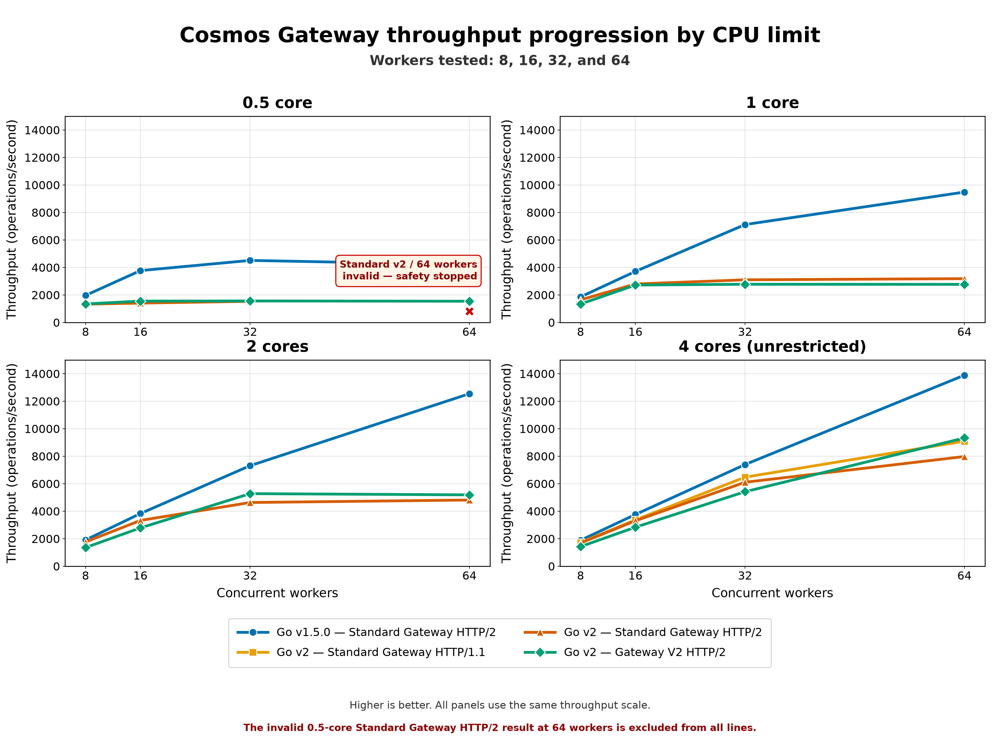
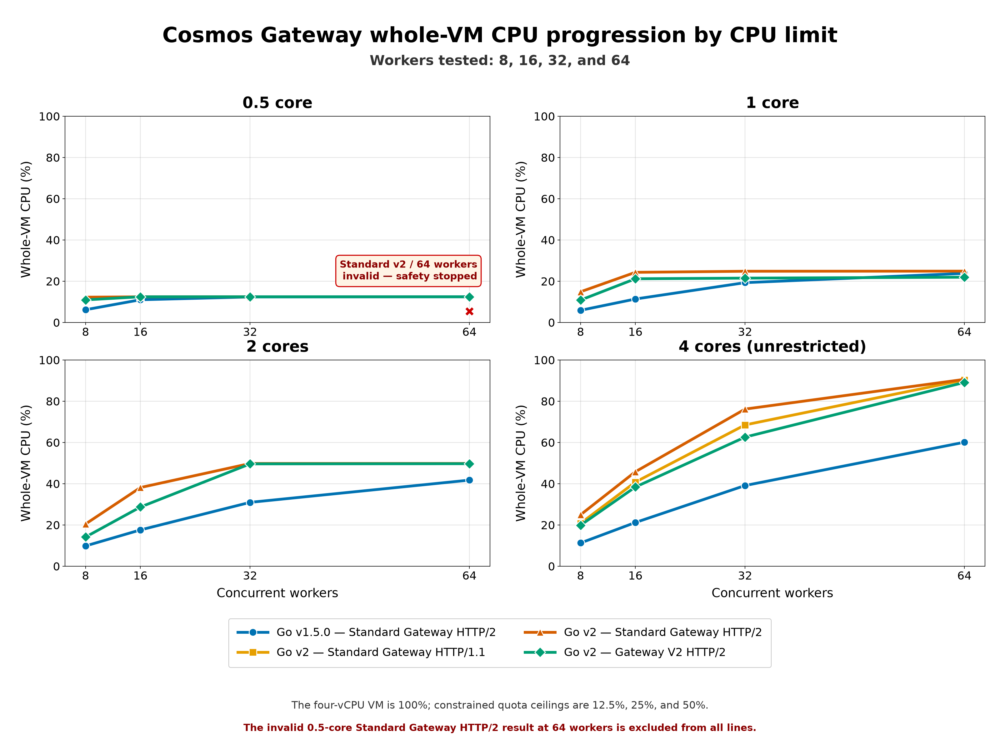
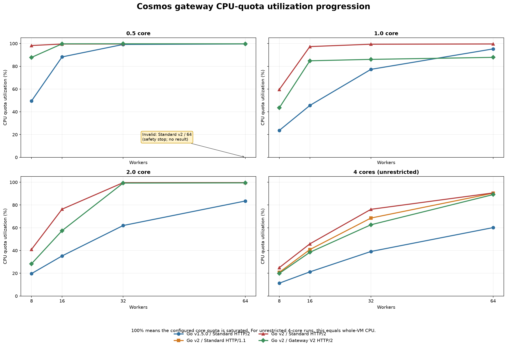
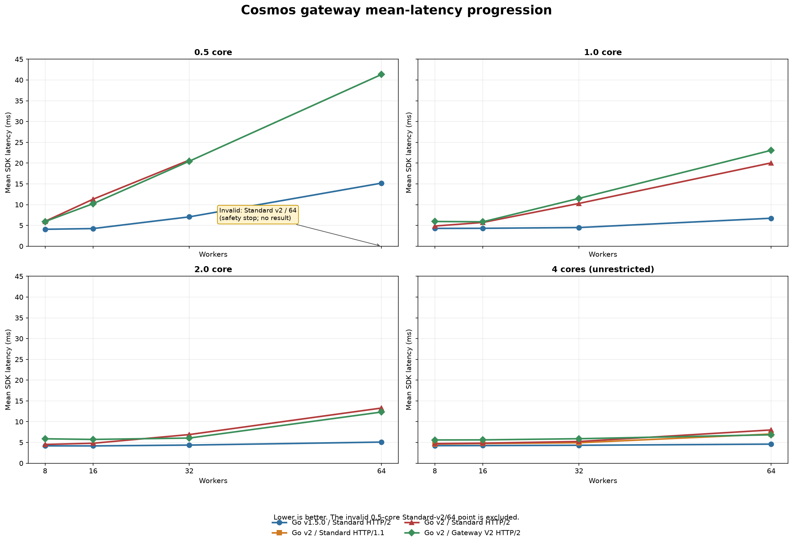
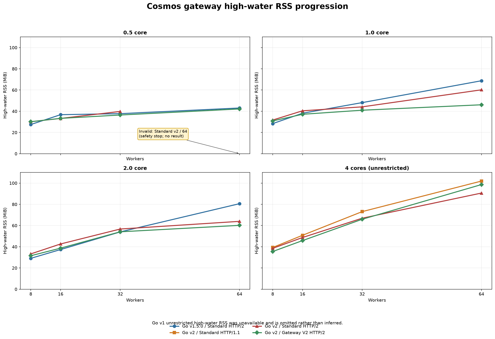

# 0.5-, 1-, 2-, and 4-core performance flywheels

> [!NOTE]
> This report records engineering evidence from the specific environment and workloads described below. It is not a release performance guarantee.

## Summary

This report combines the completed 0.5-, 1-, 2-, and unrestricted 4-core worker progressions for Go v1.5.0 and the measured Go v2 gateway configurations. It covers 51 valid points and one invalid safety-stopped point across 8, 16, 32, and 64 workers.

The constrained runs measured Go v1.5.0 Standard Gateway HTTP/2, Go v2 Standard Gateway HTTP/2, and Go v2 Gateway V2 HTTP/2. The unrestricted four-core campaign additionally measured Go v2 Standard Gateway HTTP/1.1.

All Go v2 results include merged [#27841](https://github.com/Azure/azure-sdk-for-go/pull/27841), `azcosmos/v2: prepare completions on waiting callers`, and the lazy diagnostics implementation from open [#27873](https://github.com/Azure/azure-sdk-for-go/pull/27873), `azcosmos/v2: lazily render diagnostics JSON`. The measurements therefore exclude eager diagnostics JSON rendering from the response hot path; this wording does not imply that #27873 is merged.

## Visual overview

### Throughput flywheel

*Throughput progression by workers. Higher is better. The axes are shared across panels, and the invalid 0.5-core Standard-v2/64 point is omitted and annotated.*

### Whole-VM CPU flywheel

*Whole-VM CPU progression by workers. The four-vCPU VM is 100%; constrained quotas cap at 12.5%, 25%, and 50% of whole-VM capacity.*

### CPU-quota utilization flywheel

*CPU-quota utilization progression by workers. A value near 100% means the configured 0.5-, 1-, 2-, or 4-core capacity is saturated.*

### Mean-latency flywheel

*Mean SDK latency progression by workers. Lower is better; rising latency after CPU saturation shows the cost of adding concurrency after throughput has plateaued.*

### High-water memory flywheel

*High-water RSS progression by workers. Go v1 unrestricted high-water RSS was not captured and is omitted rather than inferred.*

## CPU definitions

- **Quota utilization** is cgroup CPU use divided by the configured core quota. A 0.5-core run can be near 100% quota utilization while consuming approximately 12.5% of the four-vCPU VM.
- **Whole-VM CPU** expresses the same process CPU against all four VM vCPUs. Quota ceilings are 12.5% for 0.5 core, 25% for 1 core, 50% for 2 cores, and 100% for the unrestricted 4-core run.
- **CPU us/op** is process CPU microseconds per successful operation. It is not wall-clock latency.
- For the unrestricted campaign, quota utilization equals whole-VM CPU because the available capacity is the full four-vCPU VM.

## Results

### 0.5 core

| Implementation / transport | Workers | Status | Ops/s | Quota util. | Whole-VM CPU | CPU us/op | Mean / p95 / p99 ms | RSS / HWM MiB |
|---|---:|---|---:|---:|---:|---:|---|---|
| Go v1.5.0 / Standard HTTP/2 | 8 | Valid | 1970.5 | 49.5% | 6.2% | 192.9 | 4.07 / 7.04 / 9.50 | 27.0 / 27.5 |
| Go v1.5.0 / Standard HTTP/2 | 16 | Valid | 3774.4 | 88.2% | 11.0% | 177.6 | 4.24 / 7.34 / 9.99 | 36.6 / 36.8 |
| Go v1.5.0 / Standard HTTP/2 | 32 | Valid | 4514.9 | 99.2% | 12.4% | 166.6 | 7.06 / 37.30 / 44.53 | 35.8 / 37.7 |
| Go v1.5.0 / Standard HTTP/2 | 64 | Valid | 4204.7 | 99.7% | 12.5% | 180.0 | 15.18 / 59.85 / 63.01 | 43.1 / 43.1 |
| Go v2 / Standard HTTP/2 | 8 | Valid | 1334.8 | 98.3% | 12.3% | 571.1 | 5.98 / 15.08 / 28.98 | 30.2 / 30.2 |
| Go v2 / Standard HTTP/2 | 16 | Valid | 1411.6 | 99.6% | 12.4% | 547.3 | 11.32 / 58.54 / 67.18 | 33.2 / 33.2 |
| Go v2 / Standard HTTP/2 | 32 | Valid | 1541.8 | 99.6% | 12.5% | 499.7 | 20.72 / 73.76 / 84.69 | 38.5 / 39.8 |
| Go v2 / Standard HTTP/2 | 64 | **Invalid — safety stopped** | — | — | — | — | — | — |
| Go v2 / Gateway V2 HTTP/2 | 8 | Valid | 1350.1 | 87.8% | 11.0% | 505.1 | 5.92 / 8.39 / 10.54 | 30.1 / 30.1 |
| Go v2 / Gateway V2 HTTP/2 | 16 | Valid | 1556.2 | 99.7% | 12.5% | 495.8 | 10.23 / 49.22 / 57.58 | 32.1 / 33.3 |
| Go v2 / Gateway V2 HTTP/2 | 32 | Valid | 1567.0 | 99.8% | 12.5% | 493.0 | 20.45 / 58.69 / 66.22 | 33.3 / 36.5 |
| Go v2 / Gateway V2 HTTP/2 | 64 | Valid | 1547.0 | 99.7% | 12.5% | 499.2 | 41.33 / 74.58 / 81.35 | 42.0 / 42.2 |

The Go v2 Standard Gateway HTTP/2 run at 64 workers is the sole invalid point. A warmup Upsert returned an ambiguous write outcome, so the safety stop retained the owner and skipped the timed measurement. No throughput, latency, or CPU result is reported or inferred for that cell.

### 1 core

| Implementation / transport | Workers | Status | Ops/s | Quota util. | Whole-VM CPU | CPU us/op | Mean / p95 / p99 ms | RSS / HWM MiB |
|---|---:|---|---:|---:|---:|---:|---|---|
| Go v1.5.0 / Standard HTTP/2 | 8 | Valid | 1862.2 | 23.6% | 5.9% | 194.8 | 4.28 / 7.34 / 9.90 | 27.8 / 28.4 |
| Go v1.5.0 / Standard HTTP/2 | 16 | Valid | 3716.7 | 45.6% | 11.4% | 186.3 | 4.30 / 7.43 / 10.17 | 38.1 / 38.1 |
| Go v1.5.0 / Standard HTTP/2 | 32 | Valid | 7122.1 | 77.3% | 19.3% | 164.0 | 4.49 / 8.22 / 10.87 | 44.8 / 48.1 |
| Go v1.5.0 / Standard HTTP/2 | 64 | Valid | 9485.5 | 95.3% | 23.8% | 151.6 | 6.73 / 11.92 / 14.34 | 68.7 / 68.7 |
| Go v2 / Standard HTTP/2 | 8 | Valid | 1645.2 | 59.6% | 14.9% | 559.8 | 4.85 / 8.02 / 10.59 | 30.4 / 31.7 |
| Go v2 / Standard HTTP/2 | 16 | Valid | 2800.4 | 97.3% | 24.3% | 531.3 | 5.71 / 9.63 / 16.20 | 40.4 / 40.4 |
| Go v2 / Standard HTTP/2 | 32 | Valid | 3105.2 | 99.4% | 24.8% | 488.5 | 10.29 / 32.63 / 43.98 | 44.1 / 44.1 |
| Go v2 / Standard HTTP/2 | 64 | Valid | 3188.5 | 99.6% | 24.9% | 476.6 | 20.05 / 48.79 / 57.89 | 59.3 / 60.2 |
| Go v2 / Gateway V2 HTTP/2 | 8 | Valid | 1343.8 | 43.5% | 10.9% | 503.3 | 5.94 / 8.28 / 10.47 | 30.9 / 30.9 |
| Go v2 / Gateway V2 HTTP/2 | 16 | Valid | 2725.4 | 84.8% | 21.2% | 476.7 | 5.87 / 9.29 / 11.32 | 35.8 / 37.1 |
| Go v2 / Gateway V2 HTTP/2 | 32 | Valid | 2781.6 | 86.1% | 21.5% | 473.1 | 11.50 / 15.28 / 17.31 | 41.0 / 41.0 |
| Go v2 / Gateway V2 HTTP/2 | 64 | Valid | 2772.6 | 87.8% | 22.0% | 484.7 | 23.08 / 27.62 / 30.23 | 39.8 / 46.1 |

### 2 cores

| Implementation / transport | Workers | Status | Ops/s | Quota util. | Whole-VM CPU | CPU us/op | Mean / p95 / p99 ms | RSS / HWM MiB |
|---|---:|---|---:|---:|---:|---:|---|---|
| Go v1.5.0 / Standard HTTP/2 | 8 | Valid | 1912.3 | 19.7% | 9.9% | 316.8 | 4.19 / 7.24 / 9.79 | 29.1 / 29.1 |
| Go v1.5.0 / Standard HTTP/2 | 16 | Valid | 3833.2 | 35.2% | 17.6% | 278.9 | 4.17 / 7.21 / 9.74 | 33.2 / 37.4 |
| Go v1.5.0 / Standard HTTP/2 | 32 | Valid | 7313.3 | 62.0% | 31.0% | 256.2 | 4.37 / 7.59 / 10.31 | 50.8 / 54.0 |
| Go v1.5.0 / Standard HTTP/2 | 64 | Valid | 12550.2 | 83.5% | 41.8% | 200.9 | 5.09 / 9.20 / 11.95 | 76.9 / 80.6 |
| Go v2 / Standard HTTP/2 | 8 | Valid | 1767.8 | 41.0% | 20.5% | 714.6 | 4.52 / 7.62 / 10.19 | 32.6 / 33.3 |
| Go v2 / Standard HTTP/2 | 16 | Valid | 3329.5 | 76.3% | 38.2% | 699.6 | 4.81 / 7.88 / 10.52 | 42.6 / 42.6 |
| Go v2 / Standard HTTP/2 | 32 | Valid | 4636.1 | 99.6% | 49.8% | 652.7 | 6.90 / 22.73 / 27.88 | 56.7 / 56.7 |
| Go v2 / Standard HTTP/2 | 64 | Valid | 4816.9 | 99.7% | 49.8% | 628.5 | 13.28 / 33.23 / 38.27 | 59.4 / 63.9 |
| Go v2 / Gateway V2 HTTP/2 | 8 | Valid | 1359.0 | 28.3% | 14.2% | 647.5 | 5.88 / 8.17 / 10.32 | 31.5 / 31.5 |
| Go v2 / Gateway V2 HTTP/2 | 16 | Valid | 2789.2 | 57.4% | 28.7% | 629.4 | 5.73 / 9.07 / 11.04 | 37.9 / 38.7 |
| Go v2 / Gateway V2 HTTP/2 | 32 | Valid | 5279.7 | 99.3% | 49.6% | 571.1 | 6.06 / 10.06 / 13.74 | 41.2 / 54.1 |
| Go v2 / Gateway V2 HTTP/2 | 64 | Valid | 5192.8 | 99.4% | 49.7% | 581.8 | 12.32 / 17.93 / 21.97 | 55.7 / 60.2 |

### 4 cores (unrestricted)

| Implementation / transport | Workers | Status | Ops/s | Quota util. | Whole-VM CPU | CPU us/op | Mean / p95 / p99 ms | RSS / HWM MiB |
|---|---:|---|---:|---:|---:|---:|---|---|
| Go v1.5.0 / Standard HTTP/2 | 8 | Valid | 1889.0 | 11.3% | 11.3% | 239.0 | 4.23 / 7.19 / 9.58 | 27.3 / — |
| Go v1.5.0 / Standard HTTP/2 | 16 | Valid | 3763.0 | 21.2% | 21.2% | 225.6 | 4.25 / 7.27 / 9.96 | 40.1 / — |
| Go v1.5.0 / Standard HTTP/2 | 32 | Valid | 7397.0 | 39.1% | 39.1% | 211.7 | 4.32 / 7.33 / 9.97 | 50.0 / — |
| Go v1.5.0 / Standard HTTP/2 | 64 | Valid | 13895.0 | 60.1% | 60.1% | 173.1 | 4.60 / 7.93 / 10.70 | 76.1 / — |
| Go v2 / Standard HTTP/1.1 | 8 | Valid | 1728.0 | 20.8% | 20.8% | 481.4 | 4.62 / 7.79 / 10.39 | 39.3 / 39.3 |
| Go v2 / Standard HTTP/1.1 | 16 | Valid | 3371.0 | 40.8% | 40.8% | 484.4 | 4.74 / 7.87 / 10.41 | 47.6 / 50.8 |
| Go v2 / Standard HTTP/1.1 | 32 | Valid | 6479.0 | 68.5% | 68.5% | 423.0 | 4.93 / 8.06 / 10.55 | 63.8 / 73.1 |
| Go v2 / Standard HTTP/1.1 | 64 | Valid | 9098.0 | 90.4% | 90.4% | 397.3 | 7.03 / 10.65 / 12.92 | 92.7 / 101.9 |
| Go v2 / Standard HTTP/2 | 8 | Valid | 1690.0 | 25.0% | 25.0% | 590.8 | 4.73 / 7.77 / 10.08 | 36.6 / 38.5 |
| Go v2 / Standard HTTP/2 | 16 | Valid | 3307.0 | 45.8% | 45.8% | 554.3 | 4.83 / 7.87 / 10.53 | 45.1 / 48.7 |
| Go v2 / Standard HTTP/2 | 32 | Valid | 6108.0 | 76.2% | 76.2% | 499.0 | 5.23 / 8.27 / 10.79 | 66.0 / 66.9 |
| Go v2 / Standard HTTP/2 | 64 | Valid | 7981.0 | 90.6% | 90.6% | 454.2 | 8.01 / 12.19 / 14.59 | 79.9 / 90.6 |
| Go v2 / Gateway V2 HTTP/2 | 8 | Valid | 1427.0 | 19.9% | 19.9% | 558.0 | 5.60 / 7.85 / 10.05 | 33.4 / 35.5 |
| Go v2 / Gateway V2 HTTP/2 | 16 | Valid | 2840.0 | 38.4% | 38.4% | 541.3 | 5.62 / 8.91 / 10.80 | 44.9 / 45.8 |
| Go v2 / Gateway V2 HTTP/2 | 32 | Valid | 5422.0 | 62.6% | 62.6% | 462.0 | 5.90 / 9.42 / 11.28 | 65.9 / 65.9 |
| Go v2 / Gateway V2 HTTP/2 | 64 | Valid | 9330.0 | 89.1% | 89.1% | 382.2 | 6.85 / 10.61 / 12.64 | 98.6 / 98.6 |

The unrestricted matrix includes Standard Gateway HTTP/1.1 in addition to the three configurations in the constrained campaign. Go v1 high-water RSS and stage-attribution data were not captured, so those fields remain unavailable rather than inferred.

## Conclusions

1. Go v1.5.0 scales further before reaching each CPU ceiling and remains substantially more CPU-efficient than the measured Go v2 paths.
2. At 0.5 core, Go v1 peaks around 32 workers, while both valid Go v2 progressions plateau near 1.5K operations/second.
3. At 1 core, Standard Go v2 reaches about 3.2K operations/second; Gateway V2 peaks around 2.8K and retains lower whole-VM CPU use.
4. At 2 cores, Standard Go v2 plateaus around 4.8K operations/second. Gateway V2 peaks at 5.28K at 32 workers and regresses slightly at 64 workers as latency rises.
5. On the unrestricted VM, Gateway V2 crosses over at 64 workers and reaches 9.33K operations/second, while Standard HTTP/1.1 remains the more efficient Go v2 choice at lower concurrency.
6. The useful worker count depends on the CPU limit: adding workers after quota saturation primarily increases latency rather than throughput.

## Provenance and reproducibility

- Constrained 0.5/1/2-core source: `constrained-core-20261101-n/COMBINED-REPORT.md` and `combined-matrix-results.csv`; 0.5-core rows originated in retained campaign `constrained-core-20261030-m`.
- Constrained timed binary SHA-256: `e7b6a308f616a1eb6361992222ee89fd4d8154dcb39bfcf9e78b9bfd196341ba`.
- Constrained timed Go v2 source: `9441e941643e07d98e8d8f27dd60ff1d67981ad8`.
- Native module: `github.com/Azure/azure-cosmos-driver/linux/amd64 v0.2.0`.
- Unrestricted 4-core source: [HTTP1-vs-HTTP2-CPU-Memory-Analysis.md](HTTP1-vs-HTTP2-CPU-Memory-Analysis.md) and [data/gateway-transport-results.csv](data/gateway-transport-results.csv).
- Combined plotted data: [data/core-limit-worker-results.csv](data/core-limit-worker-results.csv).
- Raw performance captures, profiles, binaries, archives, credentials, and VM configuration are intentionally not committed.
