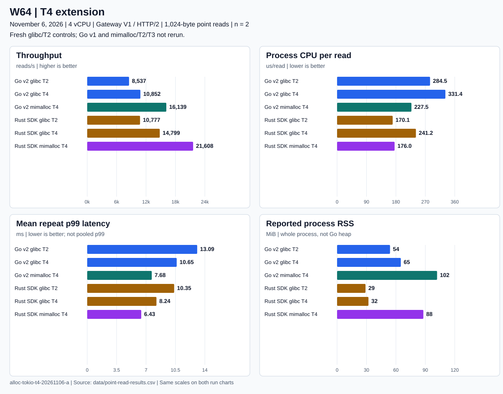
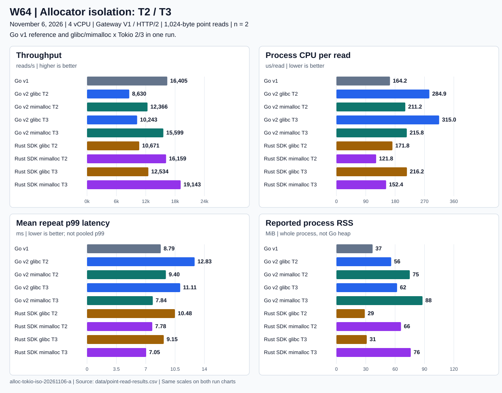

# Go v2 point-read performance results

> [!NOTE]
> Latest measurements: **November 6, 2026**, not the current SDK release.
> These are workload-specific engineering measurements on one four-vCPU VM,
> with two repeats per cell, not a release performance guarantee.

**Complete results:** all 46 rows are retained below and in the
[CSV](data/point-read-results.csv): 12 T4-extension rows, 18 isolation rows,
and all 16 previously shared W32/W64 rows. A configuration does not need an
older equivalent to be included. Route caveats affect comparisons, not retention.

## Highlights

**mimalloc improves CPU efficiency; additional Tokio workers trade CPU and
memory for throughput.** At W64 in the allocator-isolation run:

- Go v2 with mimalloc/T2 reaches **12,366 reads/s**, up 43% from glibc/T2,
  while CPU/read falls **26%** (284.9 to 211.2 us).
- Go v2 with mimalloc/T3 reaches **15,599 reads/s**, up 81% from glibc/T2,
  with **24% less CPU/read**. RSS rises from 56 to 88 MiB.
- Rust SDK with mimalloc/T2 reaches **16,159 reads/s**, within 1.5% of the
  same-run Go v1 reference (16,405), with **26% less CPU/read**.

The later T4 extension reaches **16,139 reads/s for Go v2** and **21,608 for
Rust SDK** with mimalloc, at 102 and 88 MiB RSS respectively. These are separate
runs, not additional repeats of the T2/T3 experiment.

**Read newest first:** [T4 extension](#november-6-t4-extension) /
[T2/T3 isolation](#november-6-allocator-isolation) /
[earlier point reads](#earlier-point-read-results) /
[method and evidence](#method-and-evidence).

`W32`/`W64` means 32/64 concurrent closed-loop request workers.
`T2`/`T3`/`T4` means 2/3/4 native Tokio runtime threads, not request concurrency.
CPU/read is CPU time, not latency; p50 and p99 are wall-clock latency.

## November 6: T4 extension

Latest run: `alloc-tokio-t4-20261106-a`, **24/24 valid legs**.
The T2 rows below are fresh drift controls measured in this run.
Go v1 and mimalloc/T2/T3 were not rerun here.

### W64

| Variant | Reads/s | CPU us/read | Busy cores | p50 / p99 (ms) | RSS (MiB) |
| --- | ---: | ---: | ---: | --- | ---: |
| Go v2 glibc T2 | 8,537 | 284.5 | 2.43 | 7.36 / 13.09 | 54 |
| Go v2 glibc T4 | 10,852 | 331.4 | 3.60 | 5.72 / 10.65 | 65 |
| **Go v2 mimalloc T4** | **16,139** | **227.5** | **3.67** | **3.76 / 7.68** | **102** |
| Rust SDK glibc T2 | 10,777 | 170.1 | 1.83 | 5.81 / 10.35 | 29 |
| Rust SDK glibc T4 | 14,799 | 241.2 | 3.57 | 4.17 / 8.24 | 32 |
| Rust SDK mimalloc T4 | 21,608 | 176.0 | 3.80 | 2.78 / 6.43 | 88 |

W32 results

| Variant | Reads/s | CPU us/read | Busy cores | p50 / p99 (ms) | RSS (MiB) |
| --- | ---: | ---: | ---: | --- | ---: |
| Go v2 glibc T2 | 8,098 | 299.0 | 2.42 | 3.78 / 7.72 | 51 |
| Go v2 glibc T4 | 9,638 | 344.2 | 3.32 | 3.11 / 6.94 | 54 |
| Go v2 mimalloc T4 | 10,655 | 273.2 | 2.91 | 2.81 / 6.59 | 78 |
| Rust SDK glibc T2 | 9,760 | 185.0 | 1.81 | 3.10 / 6.95 | 25 |
| Rust SDK glibc T4 | 11,237 | 259.3 | 2.91 | 2.67 / 6.37 | 26 |
| Rust SDK mimalloc T4 | 12,321 | 195.0 | 2.40 | 2.43 / 6.06 | 60 |

At W64, the glibc/T2 drift controls differ from the earlier isolation run by
**-1.1% for Go v2** and **+1.0% for Rust SDK**. This is a useful drift check,
not proof that all cross-run differences are caused by Tokio thread count.

## November 6: allocator isolation

Earlier run: `alloc-tokio-iso-20261106-a`, **36/36 valid legs**.
This is the controlled 2 x 2 comparison: glibc/mimalloc and T2/T3, with Go v1
as a same-run reference.

### W64

| Variant | Reads/s | CPU us/read | Busy cores | p50 / p99 (ms) | RSS (MiB) |
| --- | ---: | ---: | ---: | --- | ---: |
| Go v1 | 16,405 | 164.2 | 2.69 | 3.57 / 8.79 | 37 |
| Go v2 glibc T2 | 8,630 | 284.9 | 2.46 | 7.27 / 12.83 | 56 |
| Go v2 mimalloc T2 | 12,366 | 211.2 | 2.61 | 5.02 / 9.40 | 75 |
| Go v2 glibc T3 | 10,243 | 315.0 | 3.22 | 6.11 / 11.11 | 62 |
| **Go v2 mimalloc T3** | **15,599** | **215.8** | **3.37** | **3.89 / 7.84** | **88** |
| Rust SDK glibc T2 | 10,671 | 171.8 | 1.83 | 5.86 / 10.48 | 29 |
| Rust SDK mimalloc T2 | 16,159 | 121.8 | 1.97 | 3.80 / 7.78 | 66 |
| Rust SDK glibc T3 | 12,534 | 216.2 | 2.71 | 4.96 / 9.15 | 31 |
| Rust SDK mimalloc T3 | 19,143 | 152.4 | 2.92 | 3.16 / 7.05 | 76 |

W32 results

| Variant | Reads/s | CPU us/read | Busy cores | p50 / p99 (ms) | RSS (MiB) |
| --- | ---: | ---: | ---: | --- | ---: |
| Go v1 | 11,051 | 180.7 | 2.00 | 2.63 / 6.60 | 30 |
| Go v2 glibc T2 | 7,905 | 304.3 | 2.41 | 3.88 / 7.88 | 50 |
| Go v2 mimalloc T2 | 10,310 | 237.0 | 2.44 | 2.88 / 6.89 | 67 |
| Go v2 glibc T3 | 9,466 | 325.2 | 3.08 | 3.17 / 7.02 | 52 |
| Go v2 mimalloc T3 | 10,958 | 260.8 | 2.86 | 2.72 / 6.39 | 72 |
| Rust SDK glibc T2 | 9,760 | 185.1 | 1.81 | 3.09 / 6.85 | 25 |
| Rust SDK mimalloc T2 | 11,497 | 146.3 | 1.68 | 2.59 / 6.23 | 57 |
| Rust SDK glibc T3 | 10,830 | 229.7 | 2.49 | 2.73 / 6.56 | 25 |
| Rust SDK mimalloc T3 | 11,845 | 179.2 | 2.12 | 2.52 / 6.20 | 58 |

### What each change contributes at W64

Each percentage uses that SDK's **glibc/T2 baseline in this isolation run**.

| Change | Go v2 reads/s | Go v2 CPU/read | Rust SDK reads/s | Rust SDK CPU/read |
| --- | ---: | ---: | ---: | ---: |
| mimalloc at T2 | +43% | -26% | +51% | -29% |
| T3 with glibc | +19% | +11% | +17% | +26% |
| mimalloc and T3 | +81% | -24% | +79% | -11% |

The combined Go v2 throughput gain exceeds the sum of the separate gains in
these observations; two repeats are not enough to establish a general scaling
law. Memory is the tradeoff: at W64, mimalloc adds **19 MiB for Go v2/T2** and
**37 MiB for Rust SDK/T2**.

## Earlier point-read results

These are the previously shared W32/W64 figures, separated by date and source
rather than presented as one experiment. Use the isolation run above for
allocator comparisons, not ratios across these historical runs.

November 6: quick run and separate glibc baseline

`quick` = `malloc-tokio34-quick-20261106-a` (16/16 valid legs).
`baseline` = the separate `i1-i2-quick-20261106-a` glibc control.
Both used 10-second warmup and 60-second measurement per repeat.

| W | Variant | Source | Reads/s | CPU us/read | Busy cores | p50 / p99 (ms) | RSS (MiB) |
| ---: | --- | --- | ---: | ---: | ---: | --- | ---: |
| 64 | Go v1 | quick | 17,492 | 159 | 2.78 | 3.35 / 8.27 | 43 |
| 64 | Rust SDK glibc default | quick | 10,154 | 179 | 1.81 | 6.17 / 10.99 | 29 |
| 64 | Go v2 glibc T2 | baseline | 8,475 | 287 | 2.43 | 7.41 / 13.06 | 51 |
| 64 | Go v2 mimalloc T3 | quick | 15,582 | 216 | 3.37 | 3.90 / 7.85 | 92 |
| 64 | Go v2 mimalloc T4 | quick | 15,940 | 231 | 3.67 | 3.79 / 7.77 | 99 |
| 32 | Go v1 | quick | 10,972 | 181 | 1.98 | 2.64 / 6.57 | 30 |
| 32 | Rust SDK glibc default | quick | 9,481 | 189 | 1.79 | 3.20 / 6.97 | 24 |
| 32 | Go v2 glibc T2 | baseline | 7,747 | 304 | 2.36 | 3.94 / 8.04 | 44 |
| 32 | Go v2 mimalloc T3 | quick | 10,787 | 262 | 2.82 | 2.77 / 6.48 | 72 |
| 32 | Go v2 mimalloc T4 | quick | 10,714 | 271 | 2.91 | 2.79 / 6.34 | 85 |

The Rust SDK W64 repeats were 9,660 and 10,649 reads/s, about 10% apart.
Historical `default` denotes the original runtime label; it is not a new
verification of a specific Tokio thread count.

November 5: earlier Gateway V1 point reads

Source: `go-v2-ffi-flow-latest-main-20261105-a/clean-comparison`.
Each repeat used 10-second warmup and 60-second measurement; the summary's
approximately 120 seconds is the **sum of two measurements**, not one leg.

| W | Variant | Reads/s | CPU us/read | Busy cores | p50 / p99 (ms) | RSS (MiB) |
| ---: | --- | ---: | ---: | ---: | --- | ---: |
| 64 | Rust SDK glibc default | 10,631 | 172 | 1.83 | 5.88 / 10.61 | 25 |
| 64 | Go v2 glibc T2 | 8,293 | 290 | 2.40 | 7.57 / 13.57 | 52 |
| 32 | Rust SDK glibc default | 9,742 | 186 | 1.81 | 3.12 / 6.78 | 22 |
| 32 | Go v2 glibc T2 | 8,105 | 298 | 2.42 | 3.76 / 7.68 | 44 |

November 5: Go v1 results retained with a route caveat

Source: `tokio234-canonical-20261105-a`. These figures appeared in the earlier
comparison, but **Go v1's service-side route was not independently verified**.
They remain here for traceability only and are excluded from charts and
improvement calculations.

| W | Variant | Reads/s | CPU us/read | Busy cores | p50 / p99 (ms) | RSS (MiB) |
| ---: | --- | ---: | ---: | ---: | --- | ---: |
| 64 | Go v1 | 18,508 | 153 | 2.83 | 3.15 / 7.93 | 39 |
| 32 | Go v1 | 12,302 | 170 | 2.09 | 2.36 / 6.16 | 30 |

The canonical run's Go v2 paths used service-observed Gateway V2/ThinProxy,
so those rows are not included in this Gateway V1 report.

## Method and evidence

| Setting | Latest T4 and T2/T3 isolation runs |
| --- | --- |
| Host | Same four-vCPU Linux VM; same Cosmos account and container |
| Workload | Closed-loop point reads of 1,024-byte documents; W32 and W64 |
| Transport | Gateway V1, HTTP/2, binary encoding disabled |
| Authentication | Account key through a private inherited file descriptor; not AAD |
| Timing | 10-second excluded warmup, 60-second measurement per repeat |
| Repeats | Two per cell, mirrored order to reduce temporal bias |
| Run class | Clean-score; no perf or Go pprof in scored legs |
| Validity | Source summaries report zero errors, retries, and throttles in every accepted leg |
| mimalloc | `=0.1.48`, `default-features = false`, native global allocator |

Go v2 includes both the Go binding and its Rust native library. mimalloc changes
native allocations, not the Go heap allocator. The standalone Rust SDK sets
the allocator in its benchmark executable. The native source pin in the build
controllers is `77ebe786ad1012bc9ac56105e08c05fb4c65b321` in `Azure/azure-sdk-for-rust`.
Build flags include frame pointers, debug information and an ELF build ID;
release stripping is disabled.

### How to read the measurements

- **CPU us/read:** process CPU seconds / successful reads x 1,000,000.
- **Busy cores:** process CPU seconds / measurement wall seconds. Divide by four
  and multiply by 100 for the process share of four-vCPU capacity. This is not
  whole-machine utilization or proof that the remaining capacity was idle.
- **Latency:** mean of the per-repeat p50/p99 values, not percentiles of pooled
  requests. T4 and isolation throughput/CPU values are also means of repeat
  metrics; November 5 FFI throughput/CPU use summed counts and times.
- **RSS:** whole-process resident memory, not Go heap or allocation volume.
  The isolation/T4 summarizers use `memoryBytes.rss`, falling back to the first
  sorted status snapshot with `VmRSS`. Quick-run RSS uses the mean of per-repeat
  maximum status samples; November 5 FFI RSS is the measurement sample mean.
  Do not treat all historical RSS columns as identical end-of-run samples.
- Two repeats on one VM do not establish confidence intervals, a fixed noise
  threshold, or performance on another host, workload, or SDK version.

### Evidence inventory

[data/point-read-results.csv](data/point-read-results.csv) contains all 46
displayed result cells, their source run IDs and comparison status. It retains
p99.9 and high-water RSS from the isolation/T4 summaries; empty historical
fields mean **not transcribed**, not zero. Historical values preserve the
precision of the previously shared tables.

| Source | Retained evidence used for this report |
| --- | --- |
| T4 extension | `alloc-tokio-iso-20261106-a/summary-t4-mean.txt`; `vm/run_t4.sh`; `vm/t4_summary.py` |
| T2/T3 isolation | `alloc-tokio-iso-20261106-a/summary-mean.txt`; `vm/run_iso.sh`; `vm/iso_summary.py` |
| November 6 quick run | `malloc-tokio34-quick-20261106-a/comparison-table.md`, `summary-fetch.txt`, `memory-fetch.txt`; `vm/mem.py` |
| November 6 glibc baseline | `i1-i2-quick-20261106-a/summary-fetch.txt`, `legs-detail.txt` |
| November 5 FFI run | `go-v2-ffi-flow-latest-main-20261105-a/clean-comparison/summary.csv`, `report.md` |
| Go v1 route-unverified results | `tokio234-canonical-20261105-a` sanitized `comparison/summary.csv`, `report.md` |

The two charts use only W64 rows from their own run in the CSV, with common
zero-based scales between charts. No cross-run baseline or profiling category
is inferred. Raw captures, binaries, full compiler/version manifests and
per-binary hashes are **not included**; the summary exports do not independently
establish every Go/native build pin. This is a curated report of retained
measurements, not a newly executed or fully reproducible benchmark bundle.

### Why the old diagrams are absent

The earlier version of this PR measured a **5 Read : 2 PATCH : 2 Upsert** mix,
including CPU quotas and HTTP/1.1/Gateway V2 variants. Even its unrestricted
four-core rows are not equivalent to these point reads. It already included
caller-side completion preparation and lazy diagnostics, so it was not a
wholly unoptimized baseline.

Those tables and diagrams remain recoverable in Git history, but are removed
from this report. The latest clean-score summaries support the outcome charts
above; they do **not** support regenerated quota sweeps, CPU-stage attribution,
Go-heap splits, or flamegraphs. Reusing the older profiling diagrams would
misrepresent the latest runs.
